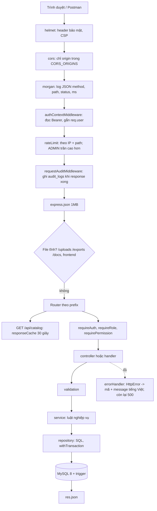
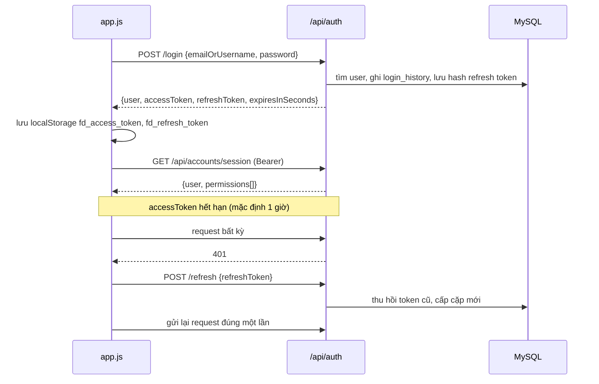
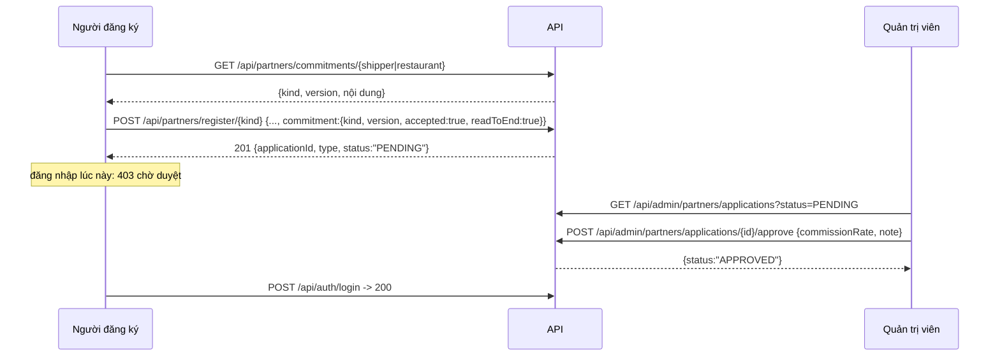
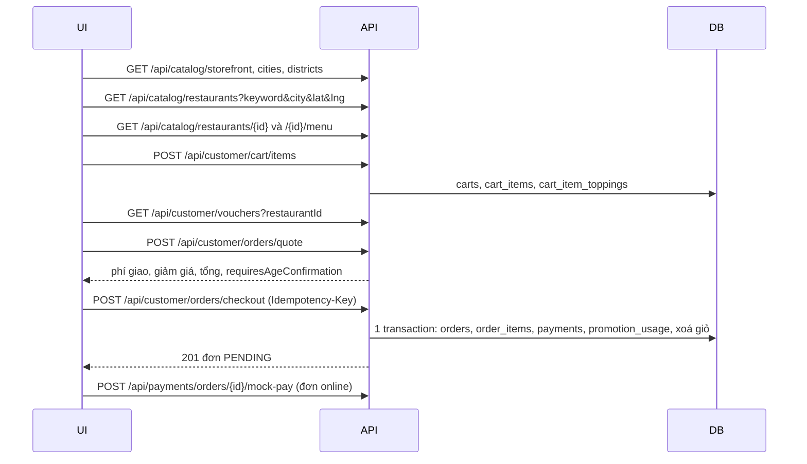
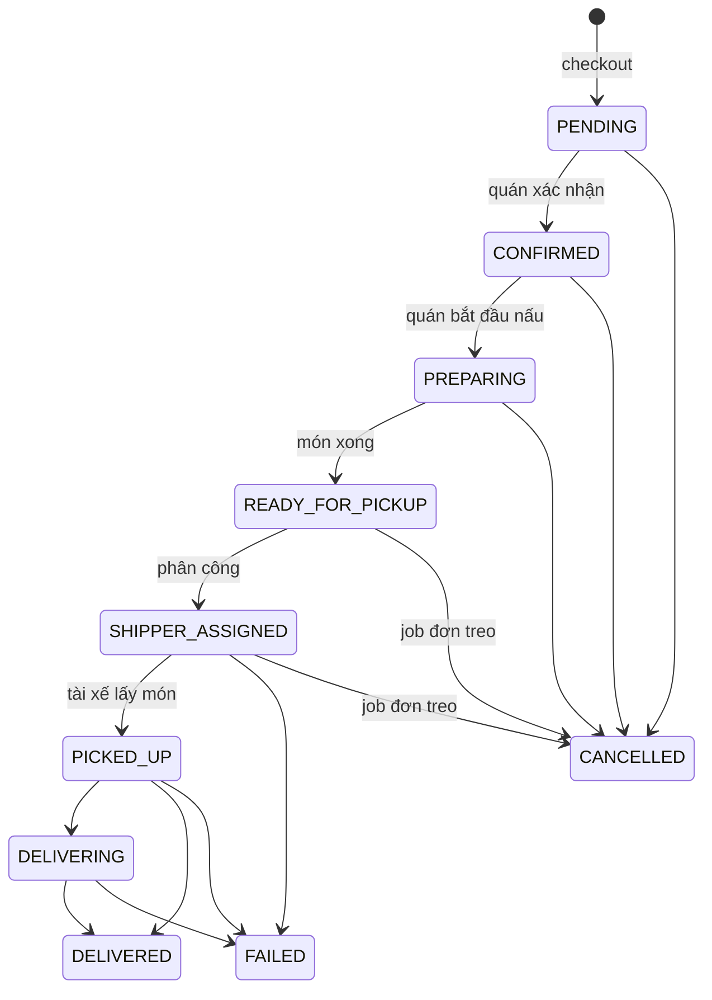
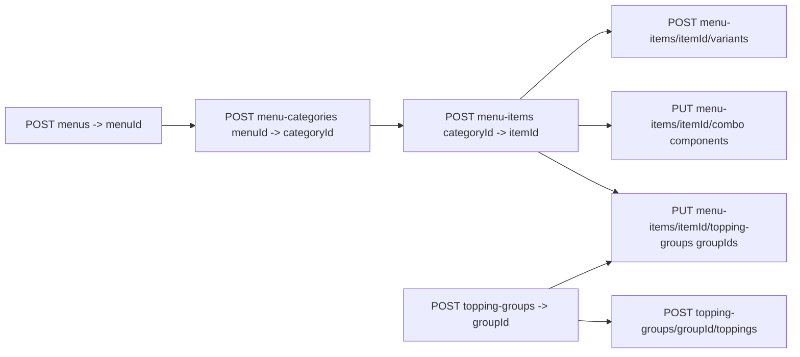
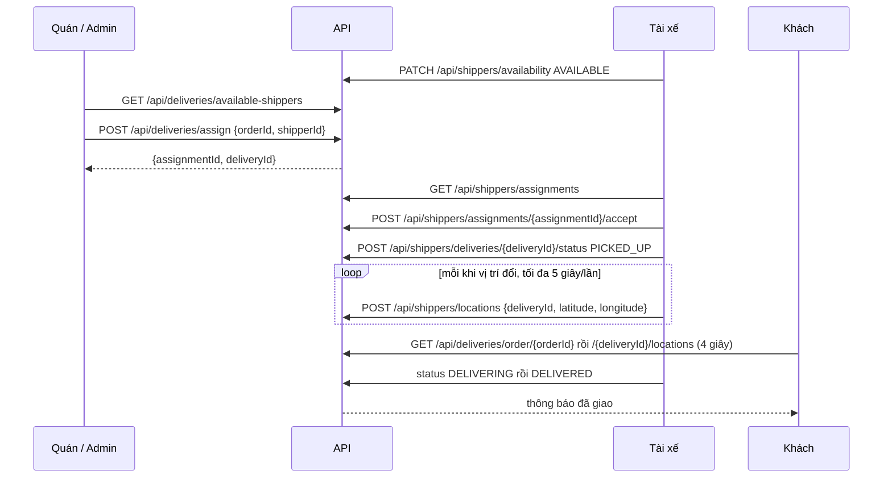
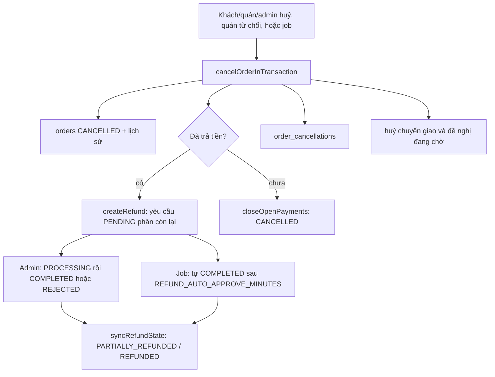

# Luồng backend FoodGo (cho người mới học dự án)

Tài liệu này đi từ một cú bấm trên giao diện xuống tới câu SQL và trigger, theo đúng code hiện tại. Đọc cùng [architecture.md](architecture.md), [business-rules.md](business-rules.md), [api-routes.md](api-routes.md), [db-schema.md](db-schema.md).

**Quy ước đường dẫn** (số dòng đúng tại ngày 27/11/2026; code đổi thì tìm theo tên hàm):

- `BE:` = `food-delivery-platform/backend/src/`
- `FE:` = `food-delivery-platform/frontend/src/`
- Ví dụ JSON được rút gọn từ lần chạy Postman trên DB bản sao; mật khẩu, token, mã bí mật thay bằng `...`.

## Mục lục

1. [Một request đi qua đâu](#1-một-request-đi-qua-đâu)
2. [Đăng nhập, JWT, refresh, phân quyền](#2-đăng-nhập-jwt-refresh-phân-quyền)
3. [Frontend nối xuống backend](#3-frontend-nối-xuống-backend)
4. [Tài khoản và đối tác](#4-tài-khoản-và-đối-tác)
5. [Khách hàng: tìm, giỏ, báo giá, đặt, trả tiền](#5-khách-hàng-tìm-giỏ-báo-giá-đặt-trả-tiền)
6. [Vòng đời đơn hàng](#6-vòng-đời-đơn-hàng)
7. [Nhà hàng](#7-nhà-hàng)
8. [Phân công, giao hàng, GPS, chat](#8-phân-công-giao-hàng-gps-chat)
9. [Huỷ đơn và hoàn tiền](#9-huỷ-đơn-và-hoàn-tiền)
10. [Đánh giá, điểm thưởng, voucher, yêu thích](#10-đánh-giá-điểm-thưởng-voucher-yêu-thích)
11. [Tiền: ví, COD, hoá đơn, đối soát](#11-tiền-ví-cod-hoá-đơn-đối-soát)
12. [Thông báo và hỗ trợ](#12-thông-báo-và-hỗ-trợ)
13. [Quản trị](#13-quản-trị)
14. [Báo cáo, xuất, nhập](#14-báo-cáo-xuất-nhập)
15. [Job nền](#15-job-nền)
16. [Trigger MySQL](#16-trigger-mysql)
17. [Bảng chức năng, API, file](#17-bảng-chức-năng--api--file)
18. [Giới hạn đã biết](#18-giới-hạn-đã-biết)

---

## 1. Một request đi qua đâu

`BE:server.js` gọi `createApp()` (`BE:app.js:48`), mở cổng (`PORT`, mặc định 3001), bật job nền (`startJobWorker`) và tắt êm khi nhận `SIGINT`/`SIGTERM` (đóng pool MySQL).



| Bước | File | Ghi chú |
|---|---|---|
| Cấu hình | `BE:shared/config/env.js:58` | Đọc `.env` bằng dotenv; biến môi trường đã đặt sẵn được ưu tiên. |
| Auth context | `BE:shared/middlewares/auth-context.middleware.js:3` | Không chặn request; token sai chỉ đặt `req.authError`. |
| Giới hạn tần suất | `BE:shared/middlewares/rate-limit.middleware.js:6` | Trong bộ nhớ tiến trình; vượt trần trả 429 kèm `Retry-After`. |
| Nhật ký | `BE:shared/middlewares/request-audit.middleware.js:12` | Handler đặt `req.auditAction`, `req.auditNewValues` để ghi chi tiết; khoá nhạy cảm trong query bị che. |
| Mount route | `BE:app.js:88` | Thứ tự mount có ý nghĩa: nhiều router dùng chung prefix `/api/catalog`, `/api/customer`, `/api/restaurant/restaurants`. |
| Cache catalog | `BE:shared/cache/response-cache.js:8` | Khoá gồm id người dùng + URL; Redis nếu có, không thì bộ nhớ. Request ghi dưới `/api/restaurant/restaurants` xoá cache (`BE:app.js:137`). |
| Bọc async | `BE:shared/http/async-handler.js:1` | Chuyển lỗi `await` sang `next(error)`. |
| Lỗi | `BE:shared/http/error-handler.js:5` | `{"message": "..."}`; 500 ghi log `http.unhandled_error` và trả câu chung. |
| Thông báo lỗi | `BE:shared/http/messages.js:79` | Mọi câu tiếng Việt nằm một chỗ. |
| Phân trang | `BE:shared/http/pagination.js:15` | `page`/`pageSize`/`limit` sai hoặc quá trần trả 400, không tự cắt. |
| Transaction | `BE:shared/database/mysql.js:81` | Tự thử lại khi deadlock; trong callback dùng `connection.execute`. |

Không phải module nào cũng đủ 4 lớp: `auth`, `orders`, `menus`, `restaurants`, `catalog`, `addresses`, `engagement` tách routes/controller/service/repository; `operations`, `management`, `partners`, `rewards`, `exports` viết SQL ngay trong file routes.

## 2. Đăng nhập, JWT, refresh, phân quyền

| API | Hàm service | Bảng |
|---|---|---|
| `POST /api/auth/register/customer` | `BE:modules/auth/auth.service.js:16` | `users`, `customer_profiles`, `refresh_tokens` |
| `POST /api/auth/login` | `BE:modules/auth/auth.service.js:59` | `users`, `login_history`, `refresh_tokens` |
| `POST /api/auth/refresh` | `BE:modules/auth/auth.service.js:99` | `refresh_tokens` (thu hồi cũ, cấp mới) |
| `POST /api/auth/logout` | `BE:modules/auth/auth.service.js:129` | thu hồi refresh token, trả 204 |
| `GET /api/auth/me` | `BE:modules/auth/auth.service.js:137` | `users` |
| `GET /api/accounts/session` | `BE:modules/operations/operations.routes.js:24` | `role_permissions` |



- **Access token**: JWT HS256 tự ký (`BE:shared/security/token.js:6`), payload `sub`, `username`, `role`, `exp`; server không lưu.
- **Refresh token**: chuỗi ngẫu nhiên, DB chỉ lưu SHA-256; hạn 30 ngày; dùng một lần.
- **Mật khẩu**: băm trong `BE:shared/security/password.js:10`; độ dài 8–72.
- **RBAC hai lớp**: `requireRole('ADMIN', ...)` so vai trò trong token (`BE:shared/middlewares/require-auth.middleware.js:18`); `requirePermission('order.create')` truy vấn `role_permissions` và yêu cầu user còn `ACTIVE` (`BE:shared/middlewares/require-permission.middleware.js:9`).
- **Quyền theo bản ghi** kiểm trong code: đơn (`BE:modules/operations/operations.routes.js:724`), chat (`BE:modules/operations/operations.routes.js:1076`), ticket, quán của chủ (`r.owner_user_id = ?`).
- **Lỗi thường gặp**: 401 thiếu/sai token hoặc sai mật khẩu; 403 sai vai trò, hoặc đăng nhập khi tài khoản chờ duyệt / ngừng hoạt động / bị khoá; 409 trùng username, email, số điện thoại.

Quên mật khẩu và xác minh email: `POST /password/forgot {email}` rồi `POST /password/reset {token, password}`; `POST /email/verification/request {email}` rồi `/confirm {token}`. **Dự án chưa gửi email thật**: response chỉ có `message`. Muốn thử trên máy thì chạy máy chủ với `AUTH_EXPOSE_TOKENS=true` (bị bỏ qua khi `NODE_ENV=production`), khi đó response kèm mã (xem [mục 18](#18-giới-hạn-đã-biết)).

## 3. Frontend nối xuống backend

`frontend/index.html` nạp `live.js`, `app.js`, `ui.js`, `analytics.js`, `address.js`, `admin.js`, `restaurant.js`, `widgets.js`, `export.js`, `commitment.js`, `partner.js` (đều `defer`). Frontend do chính Express phục vụ nên cùng origin.

| Việc | Vị trí | Chi tiết |
|---|---|---|
| Base URL | `FE:app.js:2` | `body[data-api-base]`, không có thì `window.location.origin`. |
| Trạng thái phiên | `FE:app.js:8` | `state.token`, `state.refreshToken`, `state.user`, `state.permissions`. |
| Header | `FE:app.js:213` | `Content-Type: application/json` và `Authorization: Bearer`. |
| Hàm gọi API | `FE:app.js:240` | Parse JSON; lỗi thì `throw new Error(payload.message)`; ghi nhật ký thao tác. |
| Xử lý 401 | `FE:app.js:223` | Làm mới một lần (nhiều request dùng chung một lời gọi), thất bại thì xoá phiên và mở hộp đăng nhập. |
| Lưu / xoá phiên | `FE:app.js:341` | `localStorage`. |
| Chia sẻ cho file khác | `FE:app.js:3468` | `admin.js`, `restaurant.js`, `address.js`... gọi `window.FD.api`. |
| Khởi động theo vai trò | `FE:app.js:430` | Khách: địa chỉ, giỏ, đơn, yêu thích, ticket, thông báo (song song). |
| Tải file | `FE:analytics.js:15` | Dùng `fetch` riêng kèm token (không qua `api`, nên không tự refresh). |

**Cập nhật gần thời gian thực chỉ bằng polling** (không SSE, không WebSocket):

| Chu kỳ | Nội dung | Vị trí |
|---|---|---|
| 4 giây | theo dõi đơn: đơn, chuyến giao, vị trí | `FE:live.js:191` |
| 4 giây | tin nhắn chat | `FE:live.js:251` |
| 5 giây | bản đồ chuyến đang giao (admin) | `FE:live.js:590` |
| 20 giây | bảng đơn của quán | `FE:restaurant.js:171` |
| 30 giây | số đơn chờ trên menu quán | `FE:restaurant.js:182` |
| 30 giây | chuông thông báo | `FE:widgets.js:134` |

## 4. Tài khoản và đối tác

### 4.1 Khách đăng ký

Màn hình: nút Đăng ký → form `FE:app.js:3255`.

1. `POST /api/auth/register/customer` `{"fullName":"Nguyễn A","username":"nguyen.a","email":"a@example.com","phone":"0900000000","password":"..."}` → 201 `{user, accessToken, refreshToken}`.
2. `saveSession` → `GET /api/accounts/session` → `bootstrapForRole()`.

### 4.2 Đăng ký đối tác (quán, tài xế) và duyệt



- UI: nút `data-partner` → `FE:partner.js:86` → đọc cam kết trong `FE:commitment.js:2` → gửi hồ sơ `FE:partner.js:131` (form quán lấy danh mục từ `GET /api/catalog/restaurant-categories`).
- Server: `BE:modules/partners/partner.routes.js:30`, `BE:modules/partners/partner.routes.js:78`, `BE:modules/partners/partner.routes.js:113`. Tạo `users` (`PENDING`), hồ sơ tài xế (`SUSPENDED`) + `shipper_documents`, hoặc `restaurants` (chờ duyệt), và `partner_applications`.
- Duyệt (`BE:modules/partners/partner.routes.js:180`): user `ACTIVE`; tài xế `OFFLINE` + giấy tờ `verified`; quán `ACTIVE` + hoa hồng (mặc định 15%); tạo ví nếu chưa có. Từ chối bắt buộc `note`, user thành `INACTIVE`.
- Lỗi: 400 chưa đồng ý cam kết / mật khẩu ngắn / CCCD sai; 409 trùng thông tin hoặc hồ sơ đã được xử lý.

### 4.3 Hồ sơ, địa chỉ

- `GET`/`PATCH /api/customer/profile`; method khác trả **405** kèm `Allow: GET, PATCH`.
- Địa chỉ (`FE:address.js:23`, `FE:address.js:65`): `GET/POST /api/customer/addresses`, `PATCH/DELETE /:id`, `POST /:id/default`. Toạ độ lấy từ bản đồ chọn điểm (`FE:live.js:594`) và quyết định phí giao. Server: `BE:modules/addresses/address.routes.js:16`.

## 5. Khách hàng: tìm, giỏ, báo giá, đặt, trả tiền



### 5.1 Tìm kiếm và xem quán

- UI: `FE:app.js:714` gọi song song `GET /api/catalog/restaurants` và `GET /api/catalog/menu-items`; mở quán `FE:app.js:902` gọi `/restaurants/{id}` rồi `/restaurants/{id}/menu`.
- Tham số: `keyword, city, district, categoryId, sort, openNow, hideOutOfRange, discount, promo, combo, vegetarian, spicy, minRating, priceMin, priceMax, maxPrepare, lat, lng, page|pageNumber, pageSize`.
- Server: `BE:modules/catalog/catalog.routes.js:25` → service → repository; quy tắc khớp từ và xếp hạng ở `BE:modules/catalog/search-text.js` (từ có dấu khớp đúng dấu, từ không dấu khớp trọn từ). Từ khoá của khách đăng nhập được lưu lịch sử (`GET /api/catalog/search-history`).
- Đang mở cửa: `BE:shared/time/opening-hours.js:31` theo giờ Việt Nam, ưu tiên `restaurant_operating_hours`.

### 5.2 Giỏ hàng

Mỗi khách có một giỏ cho mỗi quán.

| Thao tác | API | UI |
|---|---|---|
| Xem | `GET /api/customer/cart` | `FE:app.js:1434` |
| Thêm | `POST /api/customer/cart/items` | `FE:app.js:1318` |
| Sửa số lượng/ghi chú | `PATCH /api/customer/cart/items/{lineId}` | `FE:app.js:1722` |
| Bỏ dòng (204) | `DELETE /api/customer/cart/items/{lineId}` | `FE:app.js:1734` |
| Xoá giỏ của quán (204) | `DELETE /api/customer/cart/{restaurantId}` | `FE:app.js:1744` |

```json
// POST /api/customer/cart/items
{"restaurantId":22,"menuItemId":5375,"variantId":null,"toppingIds":[],"quantity":1,"note":"ít đá"}
// 201: toàn bộ giỏ; dùng items[].id (lineId) để sửa hoặc xoá
{"id":50828,"restaurantId":22,"minimumOrder":40000,"items":[{"id":111942,"menuItemId":5375,"quantity":1,"unitPrice":100000,"lineTotal":100000}],"subtotal":100000}
```

Server: `BE:modules/orders/order.repository.js:56` khoá hồ sơ khách và quán, kiểm món còn bán, size, số topping theo `min_select`/`max_select` (`BE:modules/orders/order.repository.js:348`). Lỗi: 409 quán ngừng nhận/món hết; 400 topping sai giới hạn.

### 5.3 Voucher và báo giá

1. `GET /api/customer/vouchers?restaurantId=..&addressId=..` — gồm cả voucher chưa đủ điều kiện (`shortfall`).
2. `POST /api/customer/orders/quote` (`BE:modules/engagement/rewards.routes.js:70`), UI `FE:app.js:1492`.

```json
{"restaurantId":22,"addressId":415,"promotionCode":"..."}
// 200
{"subtotal":200000,"deliveryFee":15000,"discountAmount":0,"totalAmount":215000,"distanceKm":0,"outOfRange":false,
 "requiresAgeConfirmation":false,"meetsMinimum":true,"promotionError":null,"bestVoucher":{"code":"COMTRUA40","discountAmount":40000},"pointsToEarn":200}
```

Báo giá không ghi DB. Công thức: `BE:modules/engagement/voucher.js:17`, phí giao `BE:shared/pricing/delivery-fee.js:15` (đọc `system_settings`). Địa chỉ không thuộc khách: 404.

### 5.4 Đặt hàng (checkout)

UI `FE:app.js:1756`: nếu báo giá có `requiresAgeConfirmation` thì hỏi xác nhận đủ 18 tuổi trước.

```json
// POST /api/customer/orders/checkout   header Idempotency-Key: web-<thời điểm>
{"restaurantId":22,"addressId":415,"paymentMethod":"MOMO","promotionCode":null,"ageConfirmed":true,
 "customerNote":null,"shipperNote":null,"needUtensils":true,"contactlessDelivery":false}
// 201
{"id":46525,"orderCode":"FD-...","status":"PENDING","paymentStatus":"PENDING","subtotal":150000,"deliveryFee":15000,"totalAmount":165000,"items":[...],"statusHistory":[...]}
```

`paymentMethod`: `COD, BANK_TRANSFER, MOMO, VNPAY, ZALOPAY, CARD, WALLET`. Trình tự trong **một transaction** (`BE:modules/orders/order.repository.js:142`):

1. Cùng `idempotency_key` đã có đơn → trả đơn cũ, không tạo thêm.
2. Khách `ACTIVE`; địa chỉ thuộc khách; giỏ của quán đang `ACTIVE`.
3. Quán đang mở cửa (bỏ qua chỉ khi `ALLOW_ORDER_WHEN_CLOSED=1` dành cho script dữ liệu).
4. Đồ có cồn, kể cả nằm trong combo: `BE:modules/orders/alcohol-rules.js:28`.
5. Món còn bán; tính lại giá từ DB (không tin giá client); đủ đơn tối thiểu.
6. Khoảng cách ≤ `max_delivery_distance`; voucher hợp lệ.
7. Ghi `orders`, `order_items` (trigger tăng `sold_count`), `order_item_toppings`, `order_status_history`, `payments` (`PENDING`), `promotion_usage` (trigger tăng `used_count`); xoá giỏ.

Sau transaction, `BE:modules/orders/order.service.js:40` gửi thông báo cho khách và chủ quán.

| Lỗi | Mã |
|---|---|
| Thiếu xác nhận 18 tuổi | 400 |
| Hồ sơ cho thấy chưa đủ 18 | 403 |
| Quán đóng cửa / giỏ trống / món hết | 409 |
| Ngoài vùng giao / dưới đơn tối thiểu / voucher sai / phương thức sai | 400 |

### 5.5 Thanh toán (sandbox)

- Đơn online: nút trên chi tiết đơn → `FE:live.js:279` → `POST /api/payments/orders/{id}/mock-pay {"outcome":"PAID"|"FAILED"}` → `{"id":46517,"orderId":46525,"status":"PAID"}`. **Không trừ tiền thật.**
- Server: `BE:modules/operations/operations.routes.js:368` → `BE:modules/operations/operations.routes.js:941`: cập nhật `payments`, ghi `payment_transactions`, đổi `orders.payment_status`. Đơn đã huỷ/thất bại: 409. Cổng thật sẽ dùng `POST /api/payments/{paymentId}/callback` (quyền `payment.manage`); trạng thái `REFUNDED` bị từ chối ở đây.
- COD: thu khi giao (mục 8).

### 5.6 Đơn của tôi

`GET /api/customer/orders?pageSize=20&pageNumber=1` (`FE:app.js:1803`), chi tiết `GET /api/customer/orders/{id}` (`FE:app.js:1900`, sau đó gắn thanh toán, theo dõi, chat qua `FE:live.js:331`). "Đặt lại" (`FE:app.js:1827`) thêm lại từng món vào giỏ.

## 6. Vòng đời đơn hàng



| Từ | Sang | Ai | API | Kiểm ở |
|---|---|---|---|---|
| PENDING | CONFIRMED / CANCELLED | quán | `/api/restaurant/orders/{id}/confirm`, `/reject` | `BE:modules/orders/order.validation.js:5` |
| CONFIRMED | PREPARING / CANCELLED | quán | `/prepare`, `/reject` | như trên |
| PREPARING | READY_FOR_PICKUP | quán | `/ready` | như trên |
| READY_FOR_PICKUP, SHIPPER_ASSIGNED | SHIPPER_ASSIGNED | quán/admin | `POST /api/deliveries/assign` | `BE:modules/operations/delivery-rules.js:17` |
| chuyến ASSIGNED/ACCEPTED | PICKED_UP / FAILED | tài xế | `/api/shippers/deliveries/{id}/status` | `BE:modules/operations/delivery-rules.js:22` |
| PICKED_UP | DELIVERING / DELIVERED / FAILED | tài xế | như trên | như trên |
| DELIVERING | DELIVERED / FAILED | tài xế | như trên | như trên |
| PENDING, CONFIRMED, PREPARING | CANCELLED | khách/quán/admin | `/api/payments/orders/{id}/cancel` | `BE:modules/orders/order-cancellation.js:10` |

Chuyển sai trả 409 (huỷ sai trạng thái trả 400). Mỗi lần đổi `order_status`, trigger `trg_order_status_history` ghi **một** dòng lịch sử; code chỉ `UPDATE` dòng đó để thêm người thực hiện và ghi chú. Câu chữ trạng thái và thông báo: `BE:shared/i18n/order-texts.js`.

`payment_status`: `PENDING → PAID → PARTIALLY_REFUNDED → REFUNDED`, hoặc `FAILED` / `CANCELLED` khi đơn đóng mà chưa thu tiền.

## 7. Nhà hàng

### 7.1 Xử lý đơn

1. `GET /api/restaurant/restaurants` (`FE:app.js:2342`).
2. Bảng đơn `GET /api/restaurant/orders` (`FE:app.js:2371`), chi tiết `GET /api/restaurant/orders/{id}`.
3. Bấm Xác nhận/Chuẩn bị/Sẵn sàng/Từ chối → `FE:app.js:2450` → `POST .../{confirm|prepare|ready|reject} {"note":"..."}`.
4. Ở `READY_FOR_PICKUP`, khung điều phối (`FE:live.js:350`) hiện danh sách tài xế rảnh và nút giao đơn.

Server: `BE:modules/orders/order.service.js:59` → `BE:modules/orders/order.repository.js:336`. Từ chối đơn đi chung luồng huỷ (mục 9).

### 7.2 Quán, giờ mở cửa, ảnh

| Việc | API |
|---|---|
| Sửa thông tin / ẩn quán | `PATCH` / `DELETE /api/restaurant/restaurants/{rid}` |
| Giờ 7 ngày | `PUT .../{rid}/operating-hours {"operatingHours":[7 mục dayOfWeek 1..7]}` hoặc `GET/PUT /api/restaurant/manage/{rid}/hours {"items":[7]}` (giao diện dùng bản này, `FE:restaurant.js:314`) |
| Ảnh | `POST/PATCH/DELETE .../{rid}/images` |
| Bật/tắt nhận đơn | `PATCH /api/restaurant/manage/{rid}/availability {"open":true}` (`FE:restaurant.js:144`) |
| Tổng quan, lịch sử | `GET /api/restaurant/manage/{rid}/stats`, `/orders` |
| Trả lời đánh giá | `POST /api/restaurant/manage/{rid}/reviews/{reviewId}/reply` |

Router: `BE:modules/restaurants/restaurant.routes.js:44`, `BE:modules/management/management.routes.js:616`.

### 7.3 Thực đơn, size, topping, combo

Thứ tự tạo (id của bước trước dùng cho bước sau):



Tất cả dưới `/api/restaurant/restaurants/{rid}`; mỗi loại có `GET/POST/PATCH/DELETE`.

```json
{"categoryId":435,"name":"Trà đào","basePrice":35000,"discountPrice":30000,"preparationTime":10}   // POST menu-items
{"name":"Size L","priceAdjustment":5000}                                                          // POST variants
{"name":"Topping","minSelect":0,"maxSelect":2}                                                    // POST topping-groups
{"groupIds":[362]}                                                                                // PUT topping-groups của món
{"components":[{"itemId":5351,"quantity":1},{"itemId":5352,"quantity":2}]}                        // PUT combo
```

- `PATCH` chỉ đổi trường được gửi.
- Giá giảm không lớn hơn giá gốc; thành phần combo là món thường cùng quán, số lượng 1–20, không trùng.
- Ảnh: gửi `imageData` (data URL) để server lưu vào `storage/` (`BE:modules/restaurants/image.storage.js:13`) hoặc `imageUrl`.
- UI: `FE:app.js:3136`, `FE:app.js:3004`, `FE:app.js:3062`, `FE:app.js:2920` (tạo nhóm/thực đơn nếu thiếu → tạo món → `PUT combo`).
- Server: `BE:modules/menus/menu.service.js:80`, `BE:modules/menus/menu.service.js:181`.

### 7.4 Voucher của quán

`GET/POST /api/restaurant/restaurants/{rid}/promotions`, `PATCH/DELETE /{pid}`, `POST /{pid}/extend {"days":7,"addQuota":50}`.

```json
{"code":"TRADAO10","name":"Giảm 10K","discountType":"FIXED_AMOUNT","discountValue":10000,"minimumOrder":50000,"usageLimit":100,"startAt":"...","endAt":"..."}
```

Chỉ `PERCENT`/`FIXED_AMOUNT`, bắt buộc hạn ngạch và hiệu lực tối đa 90 ngày. UI `FE:app.js:2842`; server `BE:modules/engagement/engagement.service.js`. Chi phí voucher quán trừ vào đối soát của quán.

## 8. Phân công, giao hàng, GPS, chat



| Bước | Server | Bảng / trigger |
|---|---|---|
| Trạng thái nhận đơn | `BE:modules/operations/operations.routes.js:89` | `OFFLINE/AVAILABLE/BUSY`; tài xế bị quản trị viên tạm khoá không tự mở được (403) |
| Phân công | `BE:modules/operations/operations.routes.js:753` | `deliveries` (một dòng mỗi đơn), `delivery_assignments` (`OFFERED`, đề nghị cũ còn chờ bị huỷ), đơn `SHIPPER_ASSIGNED` |
| Nhận | `BE:modules/operations/operations.routes.js:816` | `trg_assignment_accept`, tài xế `BUSY` |
| Từ chối | `BE:modules/operations/operations.routes.js:141` | chỉ đề nghị `OFFERED` của mình, không thì 404 |
| Cập nhật chuyến | `BE:modules/operations/operations.routes.js:844` | `trg_delivery_status_sync`; bấm lặp cùng trạng thái không ghi gì thêm |
| GPS | `BE:modules/operations/operations.routes.js:161` | `shipper_locations` (chỉ chuyến của mình), `trg_shipper_location_update` |

Khi `DELIVERED`: đơn COD thành `PAID` và có dòng `cod_transactions` (`COLLECTED`); `shipper_earnings` bằng phí giao; `restaurant_commissions` (trigger, % trên tiền món); trigger cộng thống kê khách/quán/tài xế và điểm thưởng. Khi `FAILED`: đóng giao dịch chưa thu.

UI tài xế: `FE:app.js:2176`, `FE:app.js:2243`, `FE:app.js:2287`; bản đồ và GPS thật của thiết bị `FE:live.js:499`. Theo dõi: `FE:live.js:127`.

### Chat theo đơn

`FE:live.js:209`: `POST /api/communications/chat/sessions {"orderId":..}` (có rồi thì trả phiên cũ) → `GET .../sessions/{id}/messages` mỗi 4 giây → `POST .../messages {"message":"..."}`. Chỉ người liên quan đơn và admin xem được (403). Bảng `chat_sessions`, `chat_messages`. Tài xế của phiên được ghi lúc tạo phiên: mở chat trước khi phân công thì tài xế chưa nằm trong phiên đó.

## 9. Huỷ đơn và hoàn tiền



- Khách: `FE:app.js:2009` → `POST /api/payments/orders/{id}/cancel {"reason":"..","reasonCode":"CUSTOMER_CHANGED_MIND"}` → `{"orderId":46525,"status":"CANCELLED","refundAmount":66000}`.
- Luồng chung: `BE:modules/orders/order-cancellation.js:17`.
- Hoàn thủ công: `POST /api/payments/orders/{id}/refund {"amount":99000,"reason":".."}` → `{"id":3096,"status":"PENDING"}`. Duyệt: `GET /api/admin/manage/refunds?status=PENDING`, `PATCH /api/admin/manage/refunds/{id} {"status":"COMPLETED"}` (UI `FE:admin.js:422`).
- Một nguồn duy nhất `BE:modules/payments/refund-service.js`: `BE:modules/payments/refund-service.js:32` khoá đơn, tổng hoàn không vượt số đã trả (409); yêu cầu `COMPLETED` không sửa được (409).

## 10. Đánh giá, điểm thưởng, voucher, yêu thích

### Đánh giá (chỉ đơn DELIVERED của chính khách)

| API | Body | Trigger |
|---|---|---|
| `POST /api/communications/orders/{id}/restaurant-review` | `{"rating":5,"comment":".."}` | `trg_restaurant_review_*` |
| `.../shipper-review` | như trên | `trg_shipper_review_*` |
| `.../item-reviews` | `{"items":[{"orderItemId":1,"rating":4}]}` | `trg_menu_item_review_*`; trùng 409 |

UI `FE:app.js:1990`; server `BE:modules/operations/operations.routes.js:485`. Đọc: `/api/catalog/restaurants/{id}/reviews`, `/api/catalog/menu-items/{id}/reviews`; đánh giá tài xế `GET /api/deliveries/reviews` (admin xem hết, tài xế xem của mình). Chỉ xoá mềm.

### Điểm và voucher

1. Giao thành công → `trg_order_delivered_loyalty` ghi `loyalty_transactions` (1 điểm / 1.000đ tiền món).
2. `GET /api/customer/loyalty` → `{points, rewards:[{id, pointsCost, canRedeem, missingPoints}], history}` (`FE:app.js:1581`).
3. `POST /api/customer/loyalty/rewards/{rewardId}/redeem` → 201 `{"code":"RW...","pointsSpent":..,"pointsLeft":..}` (`BE:modules/engagement/rewards.routes.js:125`): voucher cá nhân dùng một lần; thiếu điểm 400, hết quà 409.
4. Dùng `code` ở báo giá và checkout. Kiểm mã nhanh: `POST /api/customer/promotions/{restaurantId}/validate {"code":"..","subtotal":100000}`.

Điều kiện voucher: `BE:modules/engagement/voucher.js:28`. Voucher hết hạn được job chuyển `EXPIRED`.

### Yêu thích

`POST /api/customer/favorites/restaurants/{id}` hoặc `/menu-items/{id}` (bật/tắt, trả `{"isFavorite":true}`), `GET /api/customer/favorites` (`FE:app.js:2076`).

## 11. Tiền: ví, COD, hoá đơn, đối soát

| Chức năng | API | Ghi chú |
|---|---|---|
| Ví | `GET /api/payments/wallet`, `POST /wallet/deposit {"amount":..}` | `BE:modules/operations/operations.routes.js:1028`; nạp ví là **sandbox** |
| COD: xem | `GET /api/payments/cod` | lọc theo vai trò |
| COD: thu | `POST /api/payments/cod/{id}/collect` | chỉ tài xế của giao dịch hoặc admin; đã đối soát thì 409 (`BE:modules/payments/cod-service.js:13`) |
| COD: đối soát | `POST /api/payments/cod/{id}/settle` | admin; chỉ giao dịch `COLLECTED` (`BE:modules/payments/cod-service.js:22`) |
| Hoá đơn | `POST /api/payments/orders/{id}/invoice` rồi `GET /api/payments/invoices/{orderCode}` | `FE:live.js:289` |
| Thu nhập, rút tiền tài xế | `GET /api/shippers/earnings`, `POST /api/shippers/withdrawals` | `shipper_withdrawals` `PENDING` |
| Tạo kỳ đối soát | `POST /api/settlements/admin/settlements/generate {"periodStart":"2026-11-01","periodEnd":"2026-11-07"}` | `BE:modules/operations/operations.routes.js:1092` |
| Duyệt đối soát | `PATCH /api/admin/manage/settlements/{id} {"status":"PROCESSING"\|"SETTLED"\|"FAILED"}` | UI `FE:admin.js:478` |
| Quán xem | `GET /api/settlements/restaurant/settlements`, `/commissions` | `FE:app.js:2767` |

Thực nhận của quán = tiền món − hoa hồng − hoàn tiền − voucher do quán cấp. Phí giao thuộc tài xế.

## 12. Thông báo và hỗ trợ

### Thông báo

- API: `GET /api/notifications?page&pageSize`, `PATCH /{id}/read`, `PATCH|POST /read-all` → `{"updated":2,"unreadCount":0,"totalItems":15}`.
- Sinh ở `BE:modules/notifications/notification.service.js:10` (khách + chủ quán; tài xế khi đơn huỷ/thất bại), `notifyShipperAssigned`, `notifyShipperReassigned`, `BE:modules/notifications/notification.service.js:58`. `createOnce` chống gửi trùng.
- `type` chỉ nhận `ORDER, DELIVERY, PAYMENT, PROMOTION, SYSTEM, SUPPORT`.
- Hàng đợi email (`emailQueue`) chỉ nằm trong bộ nhớ, chưa gửi đi.

### Hỗ trợ

1. `POST /api/communications/support/tickets {"subject":"..","description":"..","category":"ORDER","priority":"MEDIUM","orderId":..}` → `{"id":..,"ticketCode":"SP-..","status":"OPEN"}` (`FE:app.js:2130`).
2. `GET /support/tickets` (admin thấy hết), `GET|POST /support/tickets/{id}/messages`.
3. Admin `PATCH /support/tickets/{id} {"status":"IN_PROGRESS"}` (`FE:admin.js:713`).

Server: `BE:modules/operations/operations.routes.js:614`.

## 13. Quản trị

| Màn hình (UI) | API chính | Server |
|---|---|---|
| Tổng quan `FE:admin.js:111` | `/api/admin/dashboard`, `/manage/reports`, `/dashboard/data-quality` | `BE:modules/dashboard/admin-dashboard.routes.js` |
| Đơn hàng `FE:admin.js:179` | `GET /api/admin/manage/orders[/{id}]` | `BE:modules/management/management.routes.js:97` |
| Nhà hàng `FE:admin.js:256` | `/api/admin/restaurants`, `PATCH /{id}/state {status, commissionRate}` | `BE:modules/restaurants/restaurant.routes.js` |
| Tài xế `FE:admin.js:344` | `/manage/shippers`, `PATCH /{id}/status`, `/documents`, `POST /manage/shipper-documents/{id}/verify` | `management.routes.js` |
| Khách, tài khoản `FE:admin.js:736` | `/manage/customers`, `/api/accounts/admin/users`, `PATCH .../status` | `operations.routes.js` |
| Thanh toán, hoàn tiền | `/manage/payments`, `/manage/refunds` | mục 9 |
| Khuyến mãi, quà `FE:admin.js:521` | `/manage/promotions[...]`, `/manage/loyalty-rewards` | `BE:modules/management/management.routes.js:386` |
| Banner `FE:admin.js:632` | `GET /manage/banners`, `POST/PATCH/DELETE /api/admin/banners` | `engagement.routes.js` |
| Đánh giá `FE:admin.js:666` | `/manage/reviews`, `DELETE` (ẩn) | `management.routes.js` |
| Danh mục, vùng, cấu hình `FE:admin.js:810` | `/api/admin/restaurant-categories`, `/manage/zones`, `/api/admin/system-settings/{key}` | `settings.routes.js` |
| Đối tác `FE:admin.js:883` | `/api/admin/partners/applications` | mục 4.2 |
| Nhật ký `FE:admin.js:936` | `/api/admin/audit-logs` | `BE:modules/audit/` |
| Bản đồ chuyến | `GET /api/deliveries/active` | `FE:live.js:550` |

Danh sách có phân trang trả `pagination.totalItems` và nhận `search` (hoặc `keyword`, `q`).

## 14. Báo cáo, xuất, nhập

### Phân tích

- `GET /api/analytics/admin/{overview|restaurants|items|regions|promotions|customers|shippers|finance}`
- `GET /api/analytics/restaurant/{rid}/{overview|items|promotions|customers|finance}`
- `GET /api/analytics/shipper/performance`, `/customer/spending`
- Thêm `?from=&to=` và `format=csv|xlsx|pdf` để tải đúng bảng đang xem. UI `FE:analytics.js` (`FE:analytics.js:15`), server `BE:modules/analytics/analytics.service.js:379`.

### Xuất trực tiếp

`GET /api/admin/export/{dataset}?format=` (`BE:modules/exports/export.routes.js:62`), `GET /api/restaurant/export/{rid}/{orders|revenue|menu|settlements}` (`BE:modules/exports/export.routes.js:184`). File sinh ngay trong response (`BE:modules/exports/file-writers.js:74`).

### Job xuất / nhập

| API | Mô tả |
|---|---|
| `POST /api/jobs/exports {"exportType":"ORDERS\|REVENUE\|SHIPPER\|SETTLEMENT","format":"CSV\|EXCEL\|PDF","filters":{"from","to"}}` | `BE:modules/jobs/job.service.js:52`; file ở `storage/exports`, trả `fileUrl`; loại sai 400 |
| `POST /api/jobs/imports {"jobType":"MENU_ITEMS\|RESTAURANTS","fileName":"m.csv","content":"restaurant_id,name,base_price\n22,Món A,25000"}` | `BE:modules/jobs/job.service.js:13`; trả `successRows`, `failedRows`, `errors[]` |
| `GET .../exports[/{id}]`, `.../imports[/{id}]` | theo dõi |
| `GET/POST /api/jobs/background`, `POST /background/run` | hàng đợi `CLEANUP_TOKENS`, `EXPORT` |

UI admin `FE:admin.js:829`.

## 15. Job nền

`BE:modules/jobs/job.worker.js:7` chạy 30 giây một lượt, không chạy chồng.

| Thứ tự | Hàm | Việc | Biến môi trường (mặc định, 0 = tắt) |
|---|---|---|---|
| 1 | `BE:modules/jobs/job.service.js:101` | chạy `background_jobs` đến hạn, thử tối đa 3 lần | |
| 2 | `BE:modules/orders/order-cancellation.js:85` | đơn `PENDING` quán không xác nhận → huỷ, đã trả thì sinh hoàn tiền | `PENDING_ORDER_TIMEOUT_MINUTES` (30) |
| 3 | `BE:modules/jobs/order-sweeper.js:105` | đơn kẹt bếp → huỷ; chuyến kẹt → `FAILED`; voucher quá hạn → `EXPIRED` | `STALE_ORDER_MINUTES` (180), `STALE_DELIVERY_MINUTES` (240) |
| 4 | `BE:modules/jobs/refund-sweeper.js:38` | cảnh báo admin hoàn tiền chờ lâu | `REFUND_ALERT_MINUTES` (120) |
| 5 | `BE:modules/jobs/refund-sweeper.js:10` | tự duyệt hoàn tiền của đơn huỷ/thất bại | `REFUND_AUTO_APPROVE_MINUTES` (240) |

Job chạy trên mọi tiến trình server: chạy hai server cùng một DB thì job chạy hai nơi.

## 16. Trigger MySQL

Số liệu dưới đây do trigger giữ, **không cập nhật tay** (thân trigger đầy đủ trong [db-schema.md](db-schema.md)).

| Trigger | Khi nào | Làm gì |
|---|---|---|
| `trg_order_status_history` | đổi `order_status` | ghi lịch sử |
| `trg_order_items_sold_count` | thêm dòng đơn | `menu_items.sold_count` |
| `trg_promotion_usage_counter` | thêm `promotion_usage` | `promotions.used_count` |
| `trg_assignment_accept` | nhận chuyến | gán tài xế, `BUSY` |
| `trg_delivery_status_sync` | đổi trạng thái chuyến | đồng bộ trạng thái đơn, lịch sử chuyến |
| `trg_shipper_available_after_delivery` | chuyến `DELIVERED` | tài xế `AVAILABLE` |
| `trg_shipper_location_update` | thêm vị trí | vị trí hiện tại |
| `trg_create_restaurant_commission` | đơn `DELIVERED` | hoa hồng |
| `trg_order_delivered_statistics` | đơn `DELIVERED` | tổng đơn/doanh thu/chuyến |
| `trg_order_delivered_loyalty`, `trg_loyalty_transaction_*` | đơn `DELIVERED`, giao dịch điểm | cộng điểm, số dư |
| `trg_payment_paid`, `trg_cod_collected` | thanh toán/COD thu | `orders.payment_status = PAID` |
| `trg_*_review_insert/update` | đánh giá | điểm trung bình, số lượt (không có trigger DELETE) |

## 17. Bảng chức năng → API → file

| Chức năng | API | File backend (`BE:modules/`) | File frontend (`FE:`) |
|---|---|---|---|
| Đăng ký, đăng nhập, mật khẩu | `/api/auth/*` | `auth/` | `app.js` |
| Phiên, quyền, tài khoản | `/api/accounts/*` | `operations/operations.routes.js` | `app.js`, `admin.js` |
| Hồ sơ, địa chỉ | `/api/customer/profile`, `/addresses` | `customers/`, `addresses/` | `app.js`, `address.js` |
| Đối tác | `/api/partners/*`, `/api/admin/partners/*` | `partners/` | `partner.js`, `commitment.js`, `admin.js` |
| Tìm kiếm, trang chủ | `/api/catalog/*` | `catalog/`, `engagement/` | `app.js`, `widgets.js` |
| Giỏ, checkout, đơn khách | `/api/customer/cart*`, `/orders*` | `orders/` | `app.js` |
| Báo giá, voucher, điểm | `/api/customer/orders/quote`, `/vouchers`, `/loyalty` | `engagement/rewards.routes.js`, `voucher.js` | `app.js` |
| Thanh toán, ví, COD, hoá đơn, hoàn, huỷ | `/api/payments/*` | `operations/`, `payments/` | `live.js`, `app.js`, `admin.js` |
| Đơn của quán | `/api/restaurant/orders/*` | `orders/` | `app.js`, `restaurant.js` |
| Quán, thực đơn, voucher quán | `/api/restaurant/restaurants/*` | `restaurants/`, `menus/`, `engagement/` | `app.js` |
| Tổng quan quán, giờ, đánh giá | `/api/restaurant/manage/*` | `management/` | `restaurant.js` |
| Tài xế | `/api/shippers/*` | `operations/` | `app.js`, `live.js` |
| Phân công, theo dõi | `/api/deliveries/*` | `operations/` | `live.js` |
| Chat, hỗ trợ, đánh giá | `/api/communications/*` | `operations/` | `live.js`, `app.js`, `admin.js` |
| Thông báo | `/api/notifications*` | `notifications/` | `widgets.js`, `app.js` |
| Đối soát | `/api/settlements/*` | `operations/` | `admin.js`, `app.js` |
| Quản trị | `/api/admin/*` | `management/`, `restaurants/`, `settings/`, `audit/`, `dashboard/` | `admin.js` |
| Báo cáo, xuất, nhập | `/api/analytics/*`, `*/export/*`, `/api/jobs/*` | `analytics/`, `exports/`, `jobs/` | `analytics.js`, `export.js`, `admin.js` |
| Sức khoẻ, tài liệu API | `/health`, `/api/openapi.json`, `/api/docs` | `health/`, `app.js` | |

## 18. Giới hạn đã biết

Đọc trước khi đưa ra môi trường thật:

1. **Chưa gửi email**: mã đặt lại mật khẩu và mã xác minh email được tạo nhưng không gửi đi, và mặc định không trả trong response. Cờ `AUTH_EXPOSE_TOKENS=true` chỉ để thử trên máy (ai biết email sẽ đặt lại được mật khẩu), luôn tắt ở production. Triển khai thật cần nối dịch vụ email.
2. Thanh toán online, nạp ví là sandbox; không có email, SMS, WebSocket.
3. Tài xế từ chối đề nghị: đơn vẫn `SHIPPER_ASSIGNED` với tài xế đó; khung điều phối của quán không hiện lại nút chọn tài xế (đổi tài xế phải gọi `POST /api/deliveries/assign`).
4. Khoá tài khoản không thu hồi access token đang còn hạn; route có `requirePermission` chặn ngay, route chỉ kiểm vai trò chặn khi token hết hạn.
5. Tạm khoá tài xế khi đang giao: hoàn tất chuyến sẽ đưa tài xế về `AVAILABLE`.
6. Rate limit và cache bộ nhớ theo từng tiến trình.
